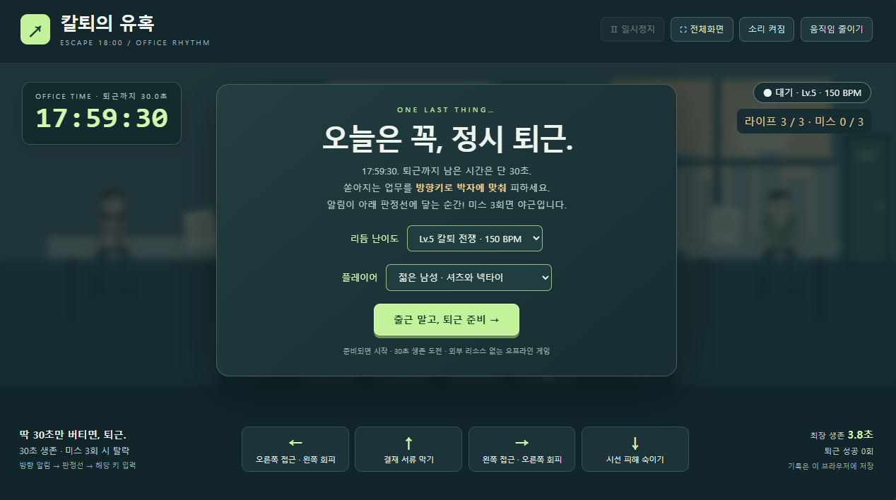
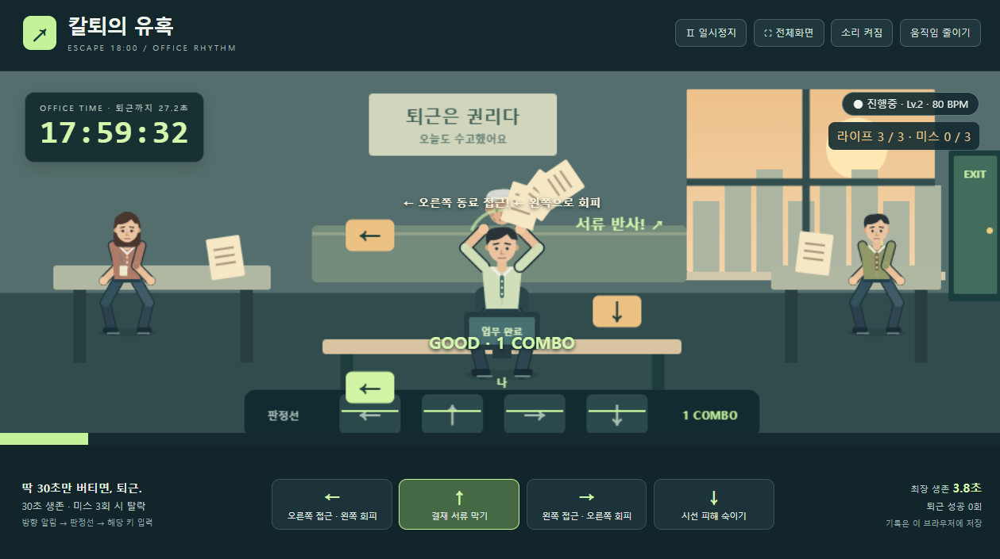
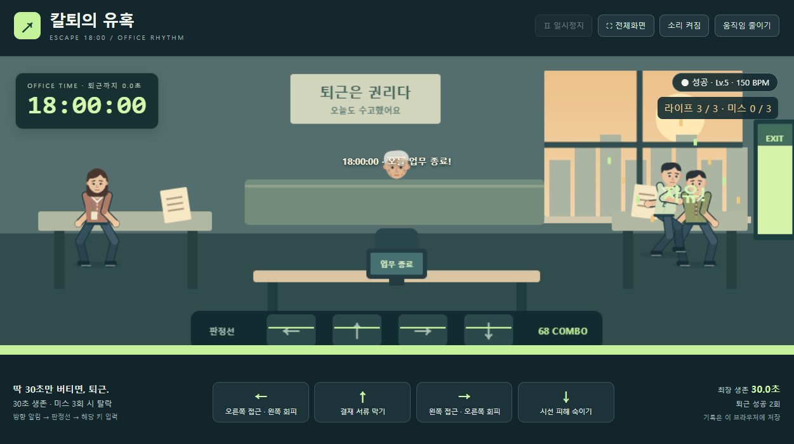

<div align="center">

<p><strong>17:59:30 — 퇴근까지, 단 30초.</strong></p>

# 칼퇴의 유혹
### Escape 18:00 · Overtime Dodger

동료의 부탁도, 부장님의 서류도, 파티션 너머 시선도.<br>
박자에 맞춰 피하고 오늘은 꼭 정시에 퇴근하세요.

<p><strong>30초 생존</strong> · <strong>방향키 4개</strong> · <strong>5단계 난이도</strong></p>

<p>
  <a href="https://dong-ddack.github.io/overtime-dodger/"><strong>🎮 지금 플레이하기</strong></a>
  &nbsp; · &nbsp;
  <a href="#조작법">조작법</a>
  &nbsp; · &nbsp;
  <a href="#화면-미리보기">화면 미리보기</a>
  &nbsp; · &nbsp;
  <a href="https://github.com/Dong-DDack/overtime-dodger/issues">버그 제보</a>
</p>

<sub>데스크톱 키보드 플레이 권장 · 설치 없이 브라우저에서 실행</sub>

</div>

---

## 오늘도 무사히, 정시 퇴근

오후 **5시 59분 30초**. 모든 업무를 마치고 시계만 바라보던 순간, 마지막 부탁들이 쏟아집니다.

**칼퇴의 유혹**은 18시가 될 때까지 업무 방해를 피하는 짧은 리듬 회피 게임입니다. 내려오는 방향 알림이 판정선에 닿는 순간, 해당 방향키를 누르세요.

| 퇴근 성공 | 야근 확정 |
| :---: | :---: |
| **30초 생존 → 18:00:00 도달** | **미스 3회 누적** |
| 문을 향해 달려가며 퇴근! | 서류 더미와 함께 야근… |

## 화면 미리보기

<!-- SCREENSHOT: gameplay — 아래 표를  로 교체하세요. -->
<table width="100%">
  <tr>
    <td align="center">
      <br><br>
      <strong>📷 GAMEPLAY</strong><br><br>
      사무실 전체와 방향키 알림이 보이는 플레이 화면<br>
      <sub>스크린샷이 들어갈 자리입니다.</sub>
      <br><br><br>
    </td>
  </tr>
</table>

<!-- SCREENSHOT: moments — 아래 표를 다음 이미지 두 장으로 교체하세요.


-->
<table width="100%">
  <tr>
    <td align="center" width="50%">
      <br><strong>🛡️ 회피 &amp; 방어</strong><br><br>
      동료를 피하거나 서류를 튕겨내는 순간<br>
      <sub>스크린샷 추가 예정</sub><br><br>
    </td>
    <td align="center" width="50%">
      <br><strong>🚪 정시 퇴근 성공</strong><br><br>
      18시를 찍고 사무실을 나서는 순간<br>
      <sub>스크린샷 추가 예정</sub><br><br>
    </td>
  </tr>
</table>

<details>
<summary>📸 스크린샷 넣는 방법</summary>

1. 캡처한 이미지를 [`docs/screenshots/`](docs/screenshots/) 폴더에 업로드합니다.
2. 파일 이름을 `gameplay.png`, `action.png`, `clear.png`로 지정합니다.
3. README의 `SCREENSHOT` 주석 바로 아래 자리표시자 표를 지우고, 주석에 적힌 이미지 문법으로 교체합니다.

첫 번째 이미지 예시:

```md

```

PNG·JPG·GIF를 사용할 수 있습니다. 파일 이름과 확장자를 바꾸면 README 경로도 맞춰 주세요. 16:9 비율로 캡처하면 게임 화면을 깔끔하게 담을 수 있습니다.

</details>

## 조작법

**방향키는 내가 움직일 방향입니다.** 동료가 다가오는 반대쪽으로 피하세요.

| 키 | 다가오는 방해 | 내 행동 |
| :---: | --- | --- |
| **←** | 오른쪽 동료의 업무 요청 | 왼쪽으로 피하기 |
| **→** | 왼쪽 동료의 업무 요청 | 오른쪽으로 피하기 |
| **↑** | 부장님의 결재 서류 투척 | 팔을 들어 막고 서류 튕겨내기 |
| **↓** | 파티션 너머에서 보내는 시선 | 모니터 아래로 숙이기 |

1. 시작 화면에서 **플레이어와 난이도**를 선택합니다.
2. 내려오는 방향 알림이 **초록색 판정선**에 닿을 때 키를 누릅니다.
3. **PERFECT / GOOD** 판정을 쌓으며 30초를 버팁니다.

알림을 놓치거나 판정 범위 안에서 다른 방향을 누르면 미스입니다. 키를 계속 누르고 있는 입력은 반복 처리하지 않으니, 매번 떼었다가 눌러 주세요.

## 나에게 맞는 퇴근 속도

| 단계 | 난이도 | 리듬 | 업무 알림 간격 |
| :---: | --- | :---: | :---: |
| Lv.1 | 여유롭게 | **60 BPM** | 1,000ms |
| Lv.2 | 가볍게 · 기본 | **80 BPM** | 750ms |
| Lv.3 | 바쁘게 | **100 BPM** | 600ms |
| Lv.4 | 아슬아슬 | **120 BPM** | 500ms |
| Lv.5 | 칼퇴 전쟁 | **150 BPM** | 400ms |

단계가 올라가면 알림이 더 자주, 더 빠르게 다가옵니다. 모든 난이도에서 플레이 시간은 **30초**, 라이프는 **3개**입니다.

## 작은 게임에 담은 것들

- **캐릭터 선택** — 젊은 남성·여성 중 선택. 왼쪽 여성 동료, 오른쪽 남성 동료, 흰머리와 주름이 있는 연장자가 등장합니다.
- **관절 애니메이션** — 발 디딤과 체중 이동이 이어지는 회피, 충돌 반동과 서류 반사, 출구를 향한 퇴근 동작을 표현했습니다.
- **전체화면** — 상단 버튼으로 확대하고 Esc로 돌아옵니다.
- **일시정지** — 버튼으로 멈추거나 다른 창으로 이동하면 자동으로 정지합니다. 돌아온 뒤 직접 재개할 수 있습니다.
- **음소거** — 효과음을 즉시 끄고 켤 수 있습니다.
- **움직임 줄이기** — 흔들림과 큰 이동을 줄이고 회피·방어를 정지 자세로 표시합니다. 리듬 속도와 판정은 같습니다.
- **개인 기록** — 최장 생존 시간과 퇴근 성공 횟수를 현재 브라우저에 저장합니다.

## 실행 방법

**온라인:** [GitHub Pages에서 바로 플레이](https://dong-ddack.github.io/overtime-dodger/)

**오프라인:** 이 저장소의 [`index.html`](index.html)을 내려받아 Chrome 또는 Edge에서 열면 됩니다. 게임 실행에는 **HTML 파일 하나만** 필요합니다.

## 만드는 방식

**HTML5 Canvas · CSS3 · Vanilla JavaScript · Web Audio API**

외부 이미지·음원·폰트·라이브러리 없이, 코드로 그린 사무실과 오실레이터 효과음을 사용합니다. 별도 설치나 빌드 과정 없이 실행할 수 있습니다.

| 파일 | 역할 |
| --- | --- |
| [`index.html`](index.html) | 화면·게임 로직·사운드를 담은 단일 실행 파일 |
| [`verify.cjs`](verify.cjs) | Node.js 내장 기능으로 실행하는 자동 검증 |
| [`TEST_REPORT.md`](TEST_REPORT.md) | 검증 결과와 수동 테스트 항목 |
| [`docs/DEVELOPMENT.md`](docs/DEVELOPMENT.md) | 판정 설정·저장 구조·유지보수 안내 |
| [`docs/screenshots/`](docs/screenshots/) | README용 스크린샷을 넣는 폴더 |

개발 검증은 저장소 폴더에서 `node verify.cjs`로 실행합니다. 현재 자동 검증은 **35개 항목을 통과**했으며, 상세 범위와 검증 한계는 [검증 기록](TEST_REPORT.md)에 정리했습니다.

GitHub Pages 게시 소스는 `main` 브랜치의 루트(`/`)입니다. 수정한 파일을 `main`에 올리면 사이트도 자동으로 갱신됩니다.

---

<div align="center">
  <strong>오늘 업무는 여기까지.</strong><br>
  <sub>18:00:00에 만나요.</sub>
</div>
